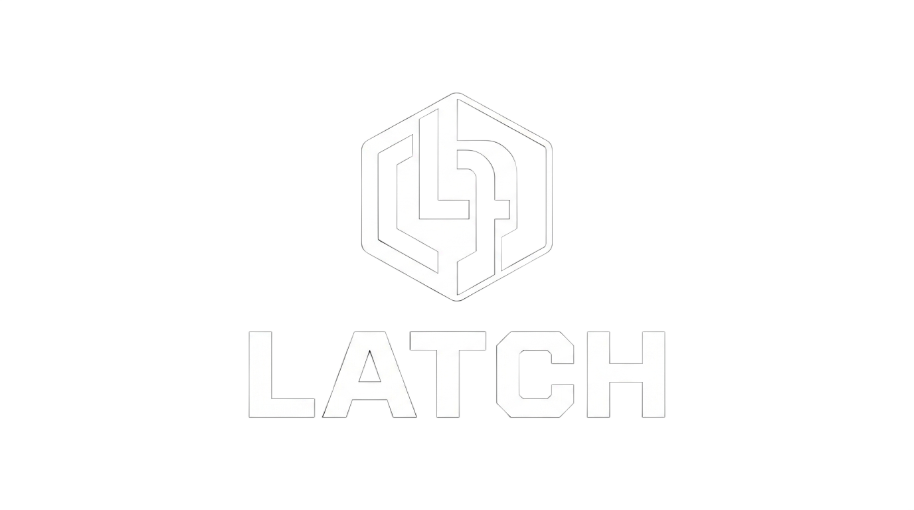

<p align="center">
  
</p>

<h1 align="center">Latch CLI</h1>

<p align="center">
  Run any AI coding agent in parallel isolated <code>git worktree</code>s from a single 4.3 MB static Rust binary.<br/>
  Zero-config interactive CLI with monochrome UI, built-in support for all major coding agents, and instant session launch.
</p>

<p align="center">
  <a href="https://github.com/fadiljee/latch-cli/actions/workflows/ci.yml">
    
  </a>
  
  
  
  
</p>

---

## Interactive CLI Preview

Run `latch-cli` inside any Git repository — it automatically starts the daemon, opens an isolated worktree session, and drops you into a clean monochrome interactive prompt:

```text
          ▄▄██▀▀▄▄
      ▄▄█▀  ██    ▀▀▄▄        L A T C H  v0.1.0
  ▄▄██▀▀█   ██▄▄▄▄▄▄  ▀▀▄▄    ────────────────────────────────────────────────────
  ██   ▄█   ██   ▀███    █    Workspace : my-repo (main)
  ██  ███   ████▄  ███   █    Agents    : All Agents Supported (codex · opencode · shell)
  ██  ███  ▀▀▀▀█▄  ▀██   █    Active    : codex  (/agent to switch · /login to sign in)
  ██  ███▄▄▄▄▄▄██  ▄██   █    Session   : 9a03fb73 (latch/my-repo/9a03fb73)
  ██▄  ▀▀████████  █▀    █
  ▀▀██▄▄▄  ▀███▀   █  ▄▄▀▀    Commands  : /new  /agent  /login  /sessions  /attach  /diff
      ▀▀██████    ▄█▀▀                    /merge  /discard  /pause  /kill  /status  /help
          ▀▀██▄▄▀▀

  ✓ Session 9a03fb73 opened (codex) on branch latch/my-repo/9a03fb73

  ┌────────────────────────────────────────────────────────────────────────────┐
  │ ❯
  └────────────────────────────────────────────────────────────────────────────┘
  codex · my-repo · session 9a03fb73 · / commands · Tab complete · Ctrl+C exit
```

---

## Why Latch?

Running multiple AI coding agent CLIs (`claude`, `codex`, `gemini`, `opencode`, `aider`, `goose`, `qwen`, or custom scripts) in parallel usually leads to three recurring problems:

1. **Heavy RAM usage** — Electron/Chromium-based orchestrators consume hundreds of MB to several GB as sessions grow.
2. **Workspace conflicts** — agents editing the same working directory overwrite each other's changes.
3. **Manual worktree management** — creating branches, inspecting diffs, checking merge conflicts, and cleaning up worktrees by hand is tedious.

**Latch** bundles both the **daemon** and **interactive CLI** into a single lightweight Rust executable (`latch-cli` / daemon alias `latchd`) with zero external runtime dependencies.

---

## Quick Start

### 1. Install

**Option A — `curl | sh` (recommended, zero Node.js required):**

```bash
curl -fsSL https://raw.githubusercontent.com/fadiljee/latch-cli/main/install.sh | sh
latch-cli
```

**Option B — `npx` / `npm`:**

```bash
# Run directly from GitHub
npx github:fadiljee/latch-cli

# Or install globally via npm (once published)
npm install -g latch-runtime
latch-cli
```

### 2. Sign in with OAuth (no API key required)

Latch is **OAuth-first** — sign in directly through your browser or existing subscription account:

```bash
# Native OAuth inside Latch (direct coding agent, no external CLI needed)
latch-cli login openrouter   # Browser OAuth PKCE (Claude / GPT / Gemini / Qwen / DeepSeek)
latch-cli login github       # GitHub account OAuth via `gh` (GitHub Models)

# Subscription OAuth Bridge (uses your installed CLI's account login)
latch-cli login antigravity  # Antigravity CLI — Google OAuth (`agy`)
latch-cli login claude       # Claude Code — Anthropic OAuth
latch-cli login codex        # OpenAI Codex — ChatGPT OAuth
latch-cli login gemini       # Gemini CLI — Google OAuth
latch-cli login opencode     # OpenCode — Provider OAuth
latch-cli login copilot      # GitHub Copilot CLI — GitHub OAuth
```

<details>
<summary>Or use an API key instead (optional)</summary>

You can save a masked API key securely (`0600` permissions in `~/.local/state/latch/auth.json`, never logged or stored in SQLite) via `latch-cli login api-key` (or `/login` → `api-key`), or export environment variables directly:

```bash
export OPENROUTER_API_KEY="sk-or-..."
export ANTHROPIC_API_KEY="sk-ant-..."
export OPENAI_API_KEY="sk-..."
export GEMINI_API_KEY="AIza..."
export GITHUB_TOKEN="ghp_..."
```

</details>

### 3. Launch right into a session

From inside any Git repository, just run:

```bash
latch-cli
```

Inside the interactive prompt (combining **Antigravity CLI** + **OpenCode** workflows):
- **Direct Coding Agent (`latch`):** 100% standalone Rust agentic loop (`rustls`, zero OpenSSL) with built-in workspace tools (`list_files`, `read_file`, `write_file`, `edit_file`, `search_text`, `run_command`), live token usage tracking, and OAuth/API-key support.
- **Bridge Streaming (OAuth CLI agents):** forwards prompts directly to `antigravity`, `codex`, `claude`, `gemini`, `opencode`, `copilot`, etc. using your account login.
- **`@file` Context Injection:** mention any workspace file inline (e.g., `refactor @src/main.rs`) to automatically attach its contents into the agent prompt.
- **`Tab` Execution Mode Switcher:** press `Tab` on an empty prompt to cycle execution modes (`confirm` → `accept-edits` → `auto` → `plan`).
- Type `/` to open the live slash-command menu (`↑`/`↓` or `PgUp`/`PgDn` to browse, `Tab` to complete, `Enter` to select):
  - `/login` — interactive OAuth login picker (OpenRouter PKCE, GitHub Models, optional API key, and all CLI agents)
  - `/auth` / `/logout` — inspect active credentials or remove stored OAuth tokens / API keys
  - `/agent` — interactive picker to switch between built-in `latch` or any external CLI agent
  - `/mode` — switch execution mode (`confirm`, `accept-edits`, `auto`, `plan`)
  - `/model` — interactive model picker (Claude Sonnet 4, GPT-4.1, Gemini 2.5 Pro, Qwen3 Coder, DeepSeek R1, etc.)
  - `/compact` — summarize conversation history to free context window
  - `/undo` — revert uncommitted worktree edits (`git checkout -- .`)
  - `/cost` — view real-time prompt/completion token usage and turn count
  - `/new` — open another parallel worktree session
  - `/sessions` — list all active & completed sessions
  - `/attach [id]` — attach interactively to a running PTY (`Ctrl-]` to detach)
  - `/diff [id]` — inspect unified git diff
  - `/merge [id]` — simulate `merge-tree` conflict check and squash-merge into the default branch
  - `/discard [id]` — remove session worktree and branch
  - `/pause` / `/resume` / `/kill` — process-group controls (`SIGSTOP` / `SIGCONT` / `SIGTERM`→`SIGKILL`)

### One-Shot CLI Commands

Every action is also available as a scriptable subcommand (add `--json` for machine-readable output):

```bash
latch-cli agents
latch-cli run --profile claude --task "Add /health endpoint" --attach
latch-cli session list
latch-cli session diff <session-id>
latch-cli session merge-check <session-id>
latch-cli session merge <session-id> --strategy squash
latch-cli session discard <session-id>
latch-cli daemon status
latch-cli daemon stop
```

---

## All Agents Supported

Built-in profiles work out of the box with zero configuration:

| Profile | Command | Auth Support |
| :--- | :--- | :--- |
| `claude` | `claude` | Account login (`latch-cli login claude`) or `ANTHROPIC_API_KEY` |
| `codex` | `codex` | Account login (`latch-cli login codex`) or `OPENAI_API_KEY` |
| `gemini` | `gemini` | Account login (`latch-cli login gemini`) or `GEMINI_API_KEY` / `GOOGLE_API_KEY` |
| `opencode` | `opencode` | Account login (`latch-cli login opencode`) or provider API keys |
| `aider` | `aider` | Provider API keys (`ANTHROPIC_API_KEY`, `OPENAI_API_KEY`, `GEMINI_API_KEY`, `OPENROUTER_API_KEY`) |
| `goose` | `goose session` | `latch-cli login goose` (`goose configure`) or provider API keys |
| `qwen` | `qwen` | Account login or `OPENAI_API_KEY` / `DASHSCOPE_API_KEY` |
| `shell` | `sh` | Interactive shell for testing or custom scripts |

To define custom agents or override defaults, generate `~/.config/latch/agents.toml`:

```bash
latch-cli init
latch-cli config check
```

---

## Measured Performance (`v0.1` release)

| Metric | Measured | Budget |
| :--- | ---: | ---: |
| Idle daemon RSS | **~10.3 MB** (10,552 kB) | ≤ 25 MB |
| Overhead per active PTY session | **~316 KB** | ≤ 5 MB |
| Release binary size | **4.3 MB** | < 30 MB |

---

## Platform Support

| Platform | Status (`v0.1`) | Notes |
| :--- | :--- | :--- |
| **Linux (x86_64)** | Supported | Primary target; static `musl` binary verified in CI; Landlock sandbox planned for `v0.3` |
| **macOS** | Partial / Experimental | Shares Unix socket & POSIX process-group foundations |
| **Windows** | WSL2 only | Native Windows support is not yet implemented |

---

## Build from Source

Requirements: **Rust** stable (edition 2024) and **Git** ≥ `2.38`.

```bash
git clone https://github.com/fadiljee/latch-cli.git
cd latch-cli

# Standard release build
cargo build --release -p latch-cli

# (Optional) Fully static musl build on Linux
rustup target add x86_64-unknown-linux-musl
cargo build --release --target x86_64-unknown-linux-musl -p latch-cli
./scripts/check-static.sh target/x86_64-unknown-linux-musl/release/latch-cli
```

---

## Contributing

Contributions are welcome! Please read [CONTRIBUTING.md](CONTRIBUTING.md) before opening a Pull Request.

---

## Roadmap

- **v0.1 (Done):** Interactive monochrome CLI (`latch-cli`), auto-open session, UDS daemon, SQLite WAL, `git worktree` + diff/merge, PTY pool, built-in multi-agent profiles + account login, `npx`/`npm` wrapper, static `musl` CI.
- **v0.2:** Local LLM reverse proxy (real-time token/cost tracking, circuit breaker), embedded Web PWA (`rust-embed`), notifications, remote tunnel.
- **v0.3:** Landlock OS sandbox (`pre_exec`), sensitive path denylist, Approval Gate.
- **v1.0:** `workflow.toml` DAG pipelines, auto-retry gate, multi-model fan-out arena, idle session hibernation.
